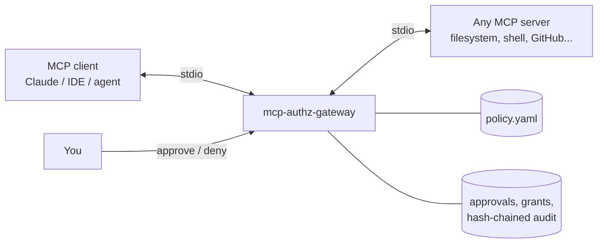

# mcp-authz-gateway

**Policy, human approval and a tamper-evident audit trail for AI agent tool calls over MCP.**

AI agents (Claude, Cursor, Copilot, custom agents) reach your files, shells, databases and SaaS accounts through
[Model Context Protocol](https://modelcontextprotocol.io) servers. Most MCP servers trust whatever the agent asks for,
so one prompt injection in a web page or README can become `rm -rf`, a leaked `.env`, or a deleted repo.

`mcp-authz-gateway` sits between the agent and any MCP server and applies the same controls you would put on a
privileged human: least privilege, just-in-time approval, short-lived grants and an audit trail.



> I recently started making my code public so more people can use it. This is one of the first projects.
> Feedback and issues are welcome.

## What it does

| Control | How |
|---|---|
| **Least privilege** | YAML rules per server and tool, with argument conditions (`glob`, `regex`, `one_of`, `max_length`...). First match wins and conditions fail closed. |
| **Hidden tools** | Tools that are always denied are removed from `tools/list`, so the agent never plans around them. |
| **Human in the loop** | `ask` rules pause the call. You answer inside your MCP client (MCP *elicitation*), or from a desktop notification plus a local approval console or the CLI. Unanswered requests are denied after a timeout. |
| **Just-in-time, short-lived grants** | Approve once, or allow a tool for N minutes. Grants expire on their own and can be revoked. |
| **Secret redaction** | API keys, tokens, JWTs and private keys are masked in tool results before the model sees them, and in arguments before they are logged. |
| **Rate limits** | e.g. `rate_limit: 60/min` on a rule, against runaway agent loops. |
| **Tamper-evident audit** | Every decision is written to a SHA-256 hash chain. `audit --verify` detects edited, inserted or deleted records; `audit --jsonl` exports to your SIEM. |
| **Path traversal safe** | Paths are normalised before matching, so `/projects/../../.ssh/id_rsa` does not pass a `/projects/**` rule. |
| **No bypass via batching** | JSON-RPC batches are split and every `tools/call` inside them is checked. |

It works with any stdio MCP server and needs no changes to the server or the client. The only dependency is PyYAML.

## Quick start

```bash
pipx install git+https://github.com/shubSaurabh/mcp-authz-gateway   # or: pip install .
mkdir -p ~/.config/mcp-authz-gateway
curl -o ~/.config/mcp-authz-gateway/policy.yaml \
  https://raw.githubusercontent.com/shubSaurabh/mcp-authz-gateway/main/examples/policy.yaml
```

Wrap a server by putting the gateway in front of its command. For Claude Desktop (`claude_desktop_config.json`):

```json
{
  "mcpServers": {
    "filesystem": {
      "command": "mcp-authz-gateway",
      "args": ["run", "--policy", "/home/you/.config/mcp-authz-gateway/policy.yaml", "--name", "filesystem",
               "--", "npx", "-y", "@modelcontextprotocol/server-filesystem", "/home/you/projects"]
    }
  }
}
```

For Claude Code:

```bash
claude mcp add filesystem -- mcp-authz-gateway run --policy ~/.config/mcp-authz-gateway/policy.yaml \
  --name filesystem -- npx -y @modelcontextprotocol/server-filesystem ~/projects
```

Test a policy before using it:

```bash
$ mcp-authz-gateway check --policy policy.yaml --server filesystem --tool read_file \
    --args '{"path": "/home/ann/projects/../.ssh/id_rsa"}'
policy.yaml: OK, 6 rule(s), default 'ask', approval mode 'auto'
filesystem.read_file -> DENY (matched rule 'never touch credentials')
```

## Policy

```yaml
default: ask              # allow | deny | ask, for calls no rule matches
hide_denied_tools: true
redact_results: true
approval:
  mode: auto              # auto | elicit | queue
  timeout: 120            # seconds, then deny
  grant_minutes: 15

rules:
  - name: never touch credentials
    tools: ["*"]
    effect: deny
    when:
      path: { glob: ["*/.ssh/*", "*/.aws/*", "*.pem", "*/.env"] }

  - name: read inside the project
    servers: [filesystem]          # optional, defaults to all servers
    tools: [read_file, list_directory]
    effect: allow
    rate_limit: 60/min
    when:
      path: { glob: "/home/*/projects/**" }

  - name: shell needs a human
    tools: [run_command]
    effect: ask
```

Conditions apply to tool arguments, and nested arguments use dots (`options.recursive`). Operators: `equals`,
`one_of`, `glob`, `not_glob`, `regex`, `not_regex`, `max_length`, `exists`. Every condition in `when` must hold.
In globs, `*` also matches `/`.

## Approving calls

- **In the client:** if your MCP client supports elicitation, a prompt appears there with *Allow once*,
  *Allow for 15 minutes* or *Deny*.
- **Console:** `mcp-authz-gateway console` opens a local page with pending calls, active grants and recent
  decisions. It listens on 127.0.0.1 only, needs a random token in the URL, checks the Host header (against DNS
  rebinding) and sends a strict CSP.
- **CLI:** `mcp-authz-gateway pending`, `approve <id> [--for 15m]`, `deny <id>`, `grants [--revoke ID]`.

```bash
mcp-authz-gateway audit                 # recent decisions
mcp-authz-gateway audit --verify        # OK: 1284 records verified; head 9977f53a4d066628
mcp-authz-gateway audit --jsonl > audit.jsonl
```

State lives in `~/.local/state/mcp-authz-gateway/gateway.db` (mode 0600). Set `--db` or `MCP_AUTHZ_GATEWAY_DB` to change it.

## Threat model and limits

Be clear about what this does and does not protect:

- It controls **what the agent can ask a server to do**. It does not sandbox the server: a server can still do
  anything its own OS permissions allow. Run servers with minimal OS permissions as well.
- Policies match on tool names and arguments, so a server with one tool that takes free-form code
  (for example `execute(code)`) can only be governed by `ask` or by regexes, which can be evaded. Prefer
  servers with narrow tools.
- The hash chain detects changes to the log, but someone with write access to the database can still truncate
  the tail or rewrite the whole chain. Export to a SIEM or WORM storage if you need stronger guarantees.
- Redaction is pattern-based and will miss secrets in formats it does not know.
- Remote MCP servers over Streamable HTTP are not proxied yet (see roadmap).

## Development

```bash
PYTHONPATH=src python3 -m unittest discover -s tests -v
```

The tests include end-to-end runs that drive the real gateway process over stdio against a fake MCP server:
allow, deny, hidden tools, redaction, queue approval, grants, timeout, elicitation, and batch bypass attempts.

## Roadmap

- Streamable HTTP transport with OAuth 2.1 token validation and per-agent identity
- Per-agent and per-session policies, and grants scoped to specific argument values
- OpenTelemetry export, and Slack or Teams approval
- Policy packs for common servers (filesystem, GitHub, Postgres, shell)

## Related work

Ideas in this space that are worth reading: the MCP
[security best practices](https://modelcontextprotocol.io/specification/draft/basic/security_best_practices),
and the authorization section of the MCP specification. This project focuses on local, policy-driven,
human-approved control of individual tool calls.

## License

[Business Source License 1.1](LICENSE). You can use, modify and self-host it for free, including in production
inside your own organization. You may not sell it or offer it as a hosted service. Each version becomes
Apache 2.0 four years after it is published. For other licensing, contact the author.

## Author

**Shubham Saurabh**: security architect working on identity, privileged access, data security and post-quantum
cryptography. [GitHub](https://github.com/shubSaurabh)
